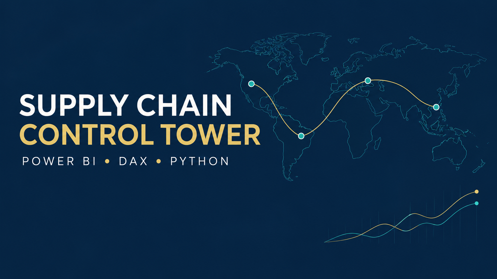

# USAID Global Health Supply Chain Control Tower



Power BI portfolio project built from USAID's public Supply Chain Shipment Pricing Data. The analysis covers health-commodity deliveries made from 2006 through 2015.

## Live dashboard

[**Open the interactive Power BI report**](https://app.powerbi.com/view?r=eyJrIjoiNjNkOTczY2ItOTAwMi00ZjUzLWE0N2ItM2I5NTE0MzNkOTUxIiwidCI6Ijc5Yzc0MmM0LWU2MWMtNGZhNS1iZTg5LWEzY2I1NjZhODBkMSIsImMiOjN9)

The report contains three interactive pages covering executive KPIs, delivery performance, and logistics cost and data quality.

## Business questions

- Which countries and shipment modes have the highest delay rates?
- Where do freight costs concentrate?
- Which vendors and manufacturing sites combine high commodity value with weak delivery performance?
- How much of the source supports freight-per-kilogram analysis?
- Which late, high-value shipments deserve investigation?

## Validated baseline

| Metric | Result |
|---|---:|
| Distinct shipments | 7,030 |
| Shipment lines | 10,324 |
| Destination countries | 43 |
| On-time delivery rate | 88.6% |
| Late shipments | 804 |
| Average delay among late shipments | 20.0 days |
| Commodity value | $1.63B |
| Recorded freight cost | $68.8M |
| Freight coverage | 88.2% |
| Freight cost per kg | $3.24 |

Air handled 4,541 shipments with a 91.5% on-time rate. Truck handled 1,442 shipments with a 79.3% on-time rate. Nigeria had the largest shipment count at 927.

## Source and provenance

USAID originally published the dataset through `data.usaid.gov` under portal identifier `a3rc-nmf6`. The former endpoint is no longer reliable, so this project downloads a versioned public GitHub mirror and records both its Git blob SHA and the local SHA-256 checksum.

- [Data.gov catalog entry](https://catalog.data.gov/dataset/supply-chain-shipment-pricing-dataset)
- [Versioned public mirror](https://github.com/UmbertoFasci/Supply-Chain-Pricing-USAID)
- Download date: 2026-10-06
- Local SHA-256: `c9ca9530539e7dbf37b377f3fcd383e1faa81c8e41c707e280b20a485508a537`

See [DATA_NOTICE.md](docs/DATA_NOTICE.md) for attribution and scope.

> **Portfolio notice:** This independent project uses historical public data and is not affiliated with or endorsed by USAID. It does not represent current USAID operations.

## Model design

The source has one row per shipment line, but weight and freight describe the shipment. Summing those fields directly from the source would duplicate logistics costs. The pipeline therefore creates two fact tables:

- `FactShipments`: one row per ASN/delivery note for delivery, weight and freight metrics;
- `FactShipmentLines`: one row per original source line for product, quantity and commodity-value metrics.

Shared dimensions cover date, country, vendor, project, manufacturing site and shipping method. Product filters the shipment-line fact only. See [model-spec.md](model/model-spec.md).

## Data-quality treatment

The pipeline retains all 10,324 source lines and converts invalid numeric labels to null rather than zero.

| Source issue | Line records |
|---|---:|
| Freight blank or nonnumeric | 4,126 |
| Weight blank or nonnumeric | 3,952 |
| Insurance missing | 287 |

The dashboard displays freight and weight coverage beside affected metrics. [Data-quality rules](docs/data-quality-rules.md) document every transformation.

## Dashboard pages

1. **Executive Overview** — headline KPIs, shipment trends and geographic performance.
2. **Delivery Performance** — on-time delivery, delays, modes, countries and vendors.
3. **Logistics Cost & Quality** — freight efficiency, commodity value and data coverage.

The detailed visual plan is in [dashboard-blueprint.md](docs/dashboard-blueprint.md).

## Repository structure

```text
├── data/
│   ├── external/                     Original downloaded CSV
│   └── processed/                    Power BI star-schema tables
├── dax/measures.dax                  DAX measure library
├── docs/                             Business case, definitions and provenance
├── model/model-spec.md               Semantic model and relationships
├── outputs/                          KPI validation and data-profile workbook
├── power-query/                      Typed Power Query ingestion
├── src/prepare_usaid_data.py         Source-to-model pipeline
├── src/analyze_usaid.py              Independent KPI calculations
├── tests/test_usaid_data.py          Reconciliation and relationship tests
├── theme/global-health-supply-chain.json
├── USAID-Supply-Chain-Control-Tower.pbip
├── USAID-Supply-Chain-Control-Tower.Report/
├── USAID-Supply-Chain-Control-Tower.SemanticModel/
└── tools/build_usaid_profile.mjs     Workbook builder
```

## Run the pipeline

```powershell
python src/prepare_usaid_data.py
python tests/test_usaid_data.py
python src/analyze_usaid.py
```

Or run:

```powershell
powershell -ExecutionPolicy Bypass -File scripts/build_project.ps1
```

## Open the Power BI report

Open `USAID-Supply-Chain-Control-Tower.pbip` in Power BI Desktop. The repository includes the report definition, semantic model and custom theme in source-controlled Power BI Project format.

The data pipeline and validation commands above reproduce the processed model inputs. The dependency-safe TMDL scripts in `model/` can also be used to reconstruct the semantic model manually.

## Skills demonstrated

- Public-data sourcing and checksum-based provenance
- Python ETL and automated reconciliation tests
- Multi-grain dimensional modeling
- Power Query ingestion
- DAX for delivery, cost, coverage and time intelligence
- Data-quality reporting
- Executive dashboard planning

## Author

Alberto del Río Jara  
[GitHub](https://github.com/adelrioj01)
